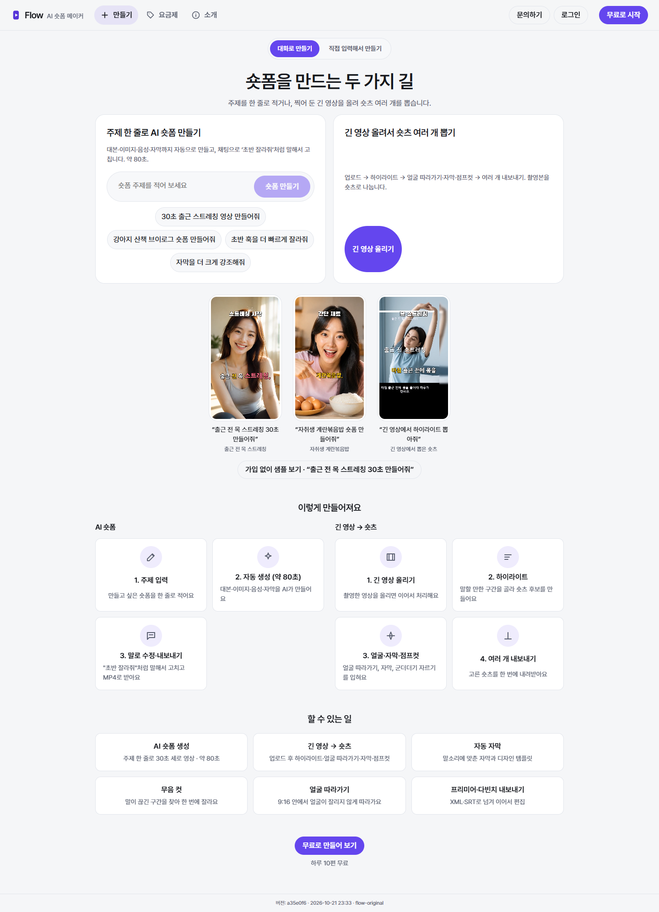
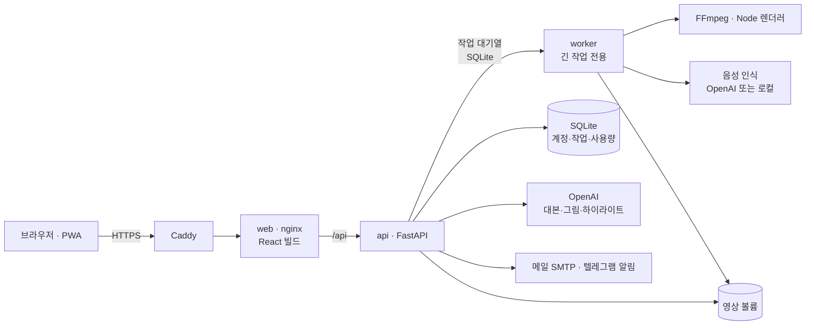
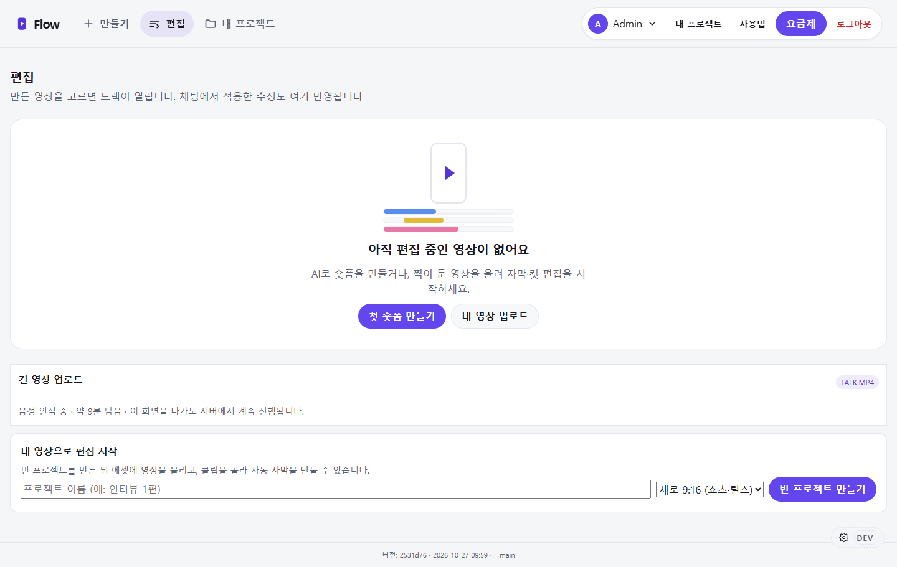
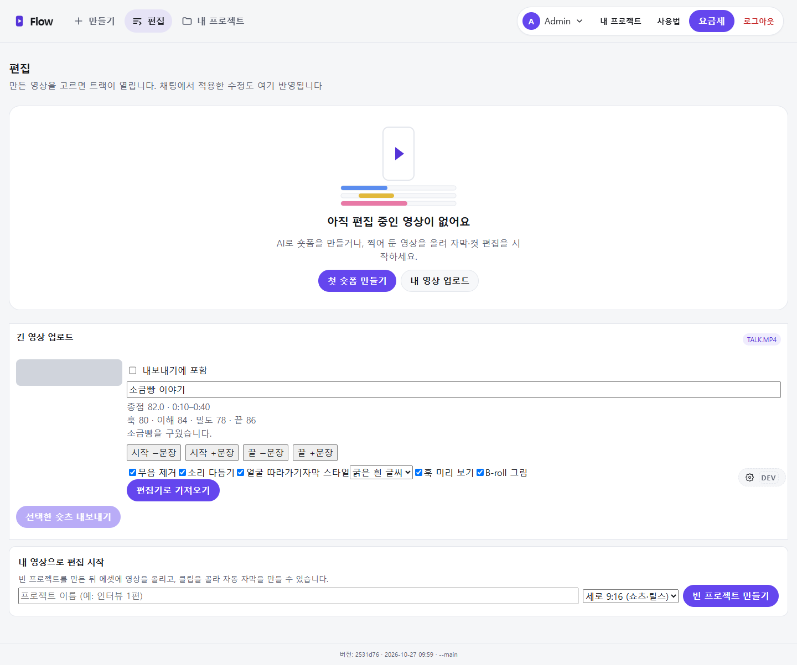
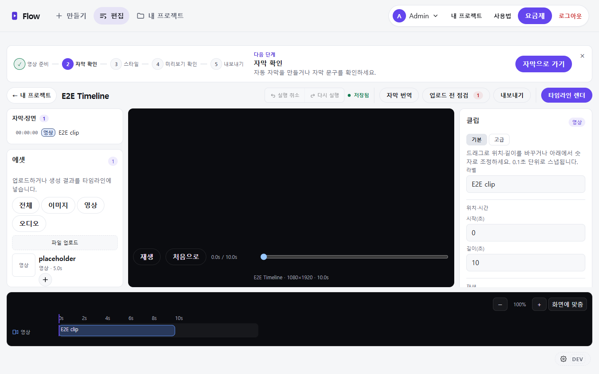
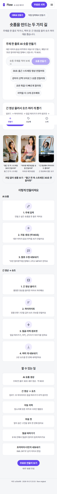
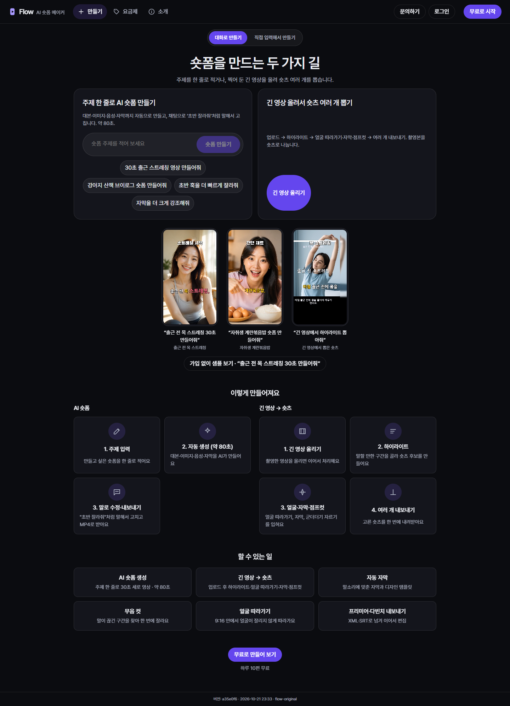

# Flow — AI 숏폼 메이커 (포트폴리오)

주제 한 줄을 적으면 대본·장면 그림·음성·자막까지 붙은 세로 숏폼이 나오고, 찍어 둔 긴 영상(10분~3시간)을 올리면 말할 만한 구간을 골라 쇼츠 여러 편으로 잘라 주는 웹 서비스입니다. 혼자 기획·설계·개발·배포 준비까지 했습니다.

> 이 저장소는 **포트폴리오용 발췌본**입니다. 실제 서비스 코드는 비공개 저장소에 있고, 여기에는 설계가 잘 드러나는 대표 코드와 설명만 담았습니다. 발췌한 파일은 원래 경로를 그대로 두었지만 이 저장소만으로는 실행되지 않습니다.

## 무엇을 하나요

| 기능 | 설명 |
|---|---|
| **주제 → 숏폼** | 주제 한 줄로 대본, 장면별 그림, 음성(TTS), 자막, 배경음을 만들어 30초 안팎의 9:16 영상으로 합성 |
| **긴 영상 → 쇼츠 여러 편** | 10분~3시간 영상을 나눠 올리면 음성 인식 → 하이라이트 고르기 → 무음·군더더기 자르기 → 얼굴 따라가기 → 자막 입혀 여러 편 내보내기 |
| **타임라인 편집기** | 클립·자막·음악 트랙 편집, 되돌리기, 자동 자막, 자막 번역, 렌더 |
| **말로 고치기** | "초반 잘라줘", "자막 더 크게"처럼 말하면 편집 명령으로 바꿔 적용 |
| **편집 프로그램 연동** | 프리미어·다빈치 리졸브용 FCPXML, SRT·VTT 자막 내보내기 |
| **계정·결제·운영** | 이메일 인증 가입, 기기별 로그아웃, 요금제(토스페이먼츠), 문의·관리자 콘솔, 장애 알림 |

| 샘플 결과 1 | 샘플 결과 2 | 샘플 결과 3 |
|---|---|---|
|  |  |  |

## 기술 스택

| 영역 | 사용 기술 |
|---|---|
| 백엔드 | Python 3.12, FastAPI, Pydantic, SQLite, OpenAI SDK, faster-whisper(로컬 음성 인식), edge-tts, FFmpeg, OpenCV |
| 프론트엔드 | React 19, TypeScript 7, Vite 8, React Router |
| 영상 합성 | FFmpeg 필터 그래프(Node 렌더러) — drawtext·ASS 자막, 점프컷, 크롭·펀치인 |
| 인프라 | Docker Compose(api · worker · web/nginx · Caddy HTTPS), 무중단에 가까운 배포 스크립트와 자동 되돌리기 |
| 품질 | pytest 1,304개 · Vitest 585개 · Playwright E2E 68개, GitHub Actions CI, ruff · oxlint · pyright |

규모: 백엔드 약 5.8만 줄(395개 파일), 프론트엔드 약 2.9만 줄(234개 파일), 시험 코드 약 3.8만 줄. 2026-08-24부터 커밋 380여 개.

## 구조

- **요청 처리(api)와 긴 작업(worker)을 나눴습니다.** 영상 합성이나 2시간짜리 음성 인식이 돌아도 화면 요청이 느려지지 않고, worker 수만 늘리면 처리량이 늘어납니다. 죽은 worker의 작업은 다른 worker가 이어받습니다.
- **비싼 AI 호출 전에 막습니다.** 사용자별 하루 한도, 사이트 전체 하루 AI 비용 상한, IP별 시간당 한도를 호출 **전에** 확인합니다.
- **남의 자료는 403이 아니라 404**로 답해 존재 자체를 숨깁니다.

자세한 설명은 [docs/ARCHITECTURE.md](docs/ARCHITECTURE.md).

## 화면

| 긴 영상 처리 중 | 쇼츠 후보 고르기 |
|---|---|
|  |  |

| 타임라인 편집기 | 모바일 | 다크 모드 |
|---|---|---|
|  |  |  |

## 해결한 문제들 (일부)

전체 이야기는 [docs/PROBLEMS_SOLVED.md](docs/PROBLEMS_SOLVED.md)에 있습니다.

| 문제 | 원인 | 해결 |
|---|---|---|
| 배포 뒤 사이트 전체가 502 | api 컨테이너만 다시 만들면 nginx가 옛 IP를 계속 씀 | Docker DNS(`resolver 127.0.0.11`)와 변수 `proxy_pass`로 10초마다 다시 찾게 함 |
| GitHub CI가 40번 연속 실패 | 실행 권한(Windows에서 안 보임), venv 경로, `pytest` 모듈 경로, Windows 전용 시험, drawtext 없는 ffmpeg — 다섯 가지가 겹침 | 하나씩 재현해 고치고 리눅스에서 1,296개 통과 |
| AI 키가 없으면 13분 뒤에야 영어 오류 | 10분 영상 업로드·음성 인식이 끝난 뒤에야 키를 확인 | 업로드 **시작 전에** 한글로 막고, SDK의 키 없음 오류를 따로 분류 |
| 14일 보관 정리가 실제로 안 돎 | 관리자 버튼으로만 돌았고, 결과 파일 이름도 못 알아봄 | 1시간마다 도는 정리에 넣고, 진행 중인 작업은 건드리지 않게 상태별 규칙과 시험 8개 |
| 백업 복원이 zip 안의 무엇이든 덮어씀 | 경로만 확인하고 파일 종류는 보지 않음 | `.env`와 DB 파일만 꺼내도록 허용 목록으로 바꿈 |
| 토큰 재발급 경쟁 | 탭 여러 개가 동시에 재발급하면 한쪽이 로그아웃됨 | 브라우저 Web Locks로 순서를 맞추고, 서버는 재발급 토큰 재사용을 감지 |

## 발췌한 코드

| 파일 | 보여 주는 것 |
|---|---|
| [`backend/app/auth/auth_service.py`](code/backend/app/auth/auth_service.py) | 가입·로그인·재발급·기기별/전체 로그아웃, 이메일 정규화, 비밀번호 재설정 때 로그인 잠금 풀기 |
| [`backend/app/security/rate_limit.py`](code/backend/app/security/rate_limit.py) | IP별 요청 제한, 무거운 작업 동시 실행 제한, 시간당 한도(슬라이딩 창, 한글 안내 + `Retry-After`) |
| [`backend/app/security/resource_ownership.py`](code/backend/app/security/resource_ownership.py) | 작업·렌더·미디어 소유권 확인(남의 것은 404) |
| [`backend/app/longform_kit/upload.py`](code/backend/app/longform_kit/upload.py) | 수 GB 영상의 나눠 올리기·이어 올리기, 디스크 여유 확인 |
| [`backend/app/longform_kit/job_queue.py`](code/backend/app/longform_kit/job_queue.py) | SQLite에 저장되는 긴 영상 대기열(사용자당·전체 동시 실행 제한) |
| [`backend/app/longform_kit/jumpcut.py`](code/backend/app/longform_kit/jumpcut.py) | 긴 무음·군더더기 말 자르기, 자른 뒤 자막 시간 다시 맞추기 |
| [`backend/app/longform_kit/disk_maintenance.py`](code/backend/app/longform_kit/disk_maintenance.py) | 보관 기간 정리(원본 3일·중간 파일 하루·결과 14일), 진행 중 작업 보호 |
| [`backend/app/services/openai_errors.py`](code/backend/app/services/openai_errors.py) | AI 오류 분류(잔액 부족·요청 과다·시간 초과·키 없음) → 다시 시도 여부와 한글 안내 |
| [`backend/app/services/env_backup.py`](code/backend/app/services/env_backup.py) | `.env`·SQLite 백업과 안전한 복원(복원 전 현재 상태 보관, 허용 목록) |
| [`backend/app/services/sqlite_utils.py`](code/backend/app/services/sqlite_utils.py) | `with` 블록이 끝나면 닫히는 SQLite 연결(시험 중 닫히지 않던 연결 약 1.4만 개를 없앰, Windows 파일 잠금 방지) |
| [`backend/app/launch_check.py`](code/backend/app/launch_check.py) | 출시 전 운영 설정 점검 도구 — 빠진 값을 한글로, 값은 출력하지 않음 |
| [`frontend/src/lib/apiClient.ts`](code/frontend/src/lib/apiClient.ts) | 쿠키 인증, 탭 간 재발급 잠금, 게이트웨이 오류를 사람이 읽는 문장으로 |
| [`frontend/src/features/longform/useLongformUpload.tsx`](code/frontend/src/features/longform/useLongformUpload.tsx) | 나눠 올리기·일시정지·새로고침 뒤 이어 올리기, 처리 상태 확인 |
| [`frontend/src/features/timeline/fcpXml.ts`](code/frontend/src/features/timeline/fcpXml.ts) | 타임라인 → FCPXML(프레임 단위 정확한 시간, 트랙별 레인) |
| [`docker-compose.yml`](code/docker-compose.yml) · [`frontend/nginx.conf`](code/frontend/nginx.conf) · [`backend/Dockerfile`](code/backend/Dockerfile) | 서비스 구성, 비권한 사용자 실행, 로그 순환, 헬스체크 |
| [`scripts/deploy.sh`](code/scripts/deploy.sh) | 빌드 → 설정 점검 → 재시작 → 상태 확인 → 실패하면 이전 이미지로 자동 되돌리기 |
| [`.github/workflows/ci.yml`](code/.github/workflows/ci.yml) | 백엔드(ruff·pytest)와 프론트엔드(oxlint·Vitest·빌드·스모크) 자동 검사 |
| 시험 예시 | [`test_longform_disk.py`](code/backend/tests/test_longform_disk.py), [`test_env_backup_restore_empty.py`](code/backend/tests/test_env_backup_restore_empty.py), [`test_launch_check.py`](code/backend/tests/test_launch_check.py), [`fcpXml.test.ts`](code/frontend/src/features/timeline/fcpXml.test.ts), [E2E 세션·메일 시나리오](code/frontend/e2e/scenarios/26-session-and-mail.spec.ts) |

## 일하는 방식

- **실제로 돌려 보고 확인합니다.** 시험 통과로 끝내지 않고, 운영과 같은 도커 환경에서 가입부터 탈퇴까지 직접 눌러 보며 버그를 찾았습니다(위 표의 502·13분 오류가 그렇게 찾은 것).
- **사용자에게 보이는 문장은 모두 한글로, 원인과 다음 행동을 함께** 적습니다. 서버 오류 원문(HTML, 영어 SDK 메시지)이 화면에 나가지 않게 막습니다.
- **비밀값은 화면·로그·저장소 어디에도 남기지 않습니다.** 운영에서는 인증·비밀번호 재설정 링크도 로그에 남기지 않습니다.
- **비용이 드는 호출은 그 전에 막습니다.** 한도와 예산을 먼저 확인하고, 음성 인식은 AI 잔액이 없거나 실패하면 로컬 인식으로 넘어갑니다.

## 저작권

포트폴리오 열람용으로 공개합니다. 복제·수정·배포·상업적 이용은 허락 없이 할 수 없습니다([LICENSE](LICENSE)).
