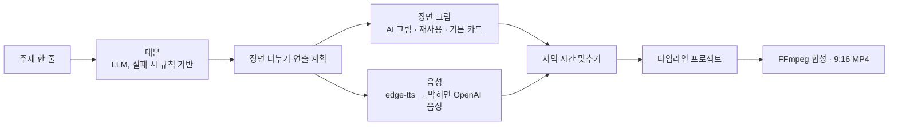
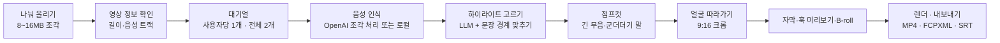

# 구조 설명

## 1. 서비스 구성

| 서비스 | 역할 |
|---|---|
| **web** (nginx) | React 빌드 결과를 내보내고 `/api`를 api로 넘김. Docker DNS로 api 주소를 10초마다 다시 찾아, api만 다시 띄워도 끊기지 않음 |
| **api** (FastAPI) | 인증, 요청 검증, 한도 확인, 작업 등록, 결과 조회. 오래 걸리는 일은 직접 하지 않음 |
| **worker** | api와 같은 이미지. 영상 생성, 타임라인 렌더, 긴 영상 처리처럼 수 분~수십 분 걸리는 일을 대기열에서 꺼내 실행 |
| **Caddy** | HTTPS 인증서 자동 발급과 갱신 |

api와 worker는 같은 볼륨(데이터·영상·캐시)을 공유하고, 작업은 SQLite 대기열로 주고받습니다. worker는 주기적으로 살아 있다고 기록하고, 일정 시간 기록이 없는 worker의 작업은 "대기"로 되돌려 다른 worker가 이어받습니다.

## 2. 주제 → 숏폼

- 그림은 예산 안에서만 AI로 만들고, 넘으면 이미 만든 그림을 다른 움직임으로 재사용합니다. AI가 꺼져 있으면 디자인된 기본 카드로 만듭니다.
- 무료 음성(edge-tts)은 비공식 서비스라 막힐 수 있어, 실패하면 같은 성별의 유료 음성으로 **영상 전체를** 다시 읽고(목소리가 중간에 바뀌지 않게), 연속 3번 실패하면 10분 동안 건너뜁니다.

## 3. 긴 영상 → 쇼츠 여러 편

- **이어 올리기:** 조각마다 받은 기록을 남겨, 새로고침하거나 네트워크가 끊겨도 받은 조각부터 이어 올립니다. 업로드 전에 디스크 여유와 파일 한도를 확인합니다.
- **AI 키가 없으면 올리기 전에 막습니다.** 하이라이트는 LLM이 꼭 필요하므로, 업로드와 음성 인식(수 분)이 끝난 뒤가 아니라 시작 전에 한글로 안내합니다.
- **중간에 멈춰도 이어서:** 단계별 결과(음성 인식, 하이라이트)를 저장해 두고, 작업이 다시 시작되면 끝난 단계는 건너뜁니다.
- **보관 기간:** 원본 업로드 3일, 중간 파일 하루, 결과 14일. 1시간마다 정리하며, 진행 중인 작업은 건드리지 않습니다.

## 4. 인증과 보안

| 항목 | 방식 |
|---|---|
| 토큰 | 접근 토큰 30분 + 재발급 토큰, HttpOnly·Secure·SameSite=Lax 쿠키. 쿠키로 인증하는 요청은 사용자 지정 헤더가 있어야 받음(CSRF 방어) |
| 세션 | 로그인마다 세션(`sid`). "이 기기만 로그아웃"과 "모든 기기 로그아웃"을 구분 |
| 재발급 | 재발급 토큰은 한 번만 쓸 수 있고, 이미 바뀐 토큰이 다시 오면 그 기기를 로그아웃. 브라우저 탭끼리는 Web Locks로 재발급 순서를 맞춤 |
| 계정 | 이메일 앞뒤 공백·대문자 무시, 이메일 인증, 로그인 실패 잠금, 비밀번호 재설정 링크 1회용 |
| 소유권 | 남의 작업·렌더·미디어는 404(존재를 숨김) |
| 남용 방지 | IP별 요청 제한, 무거운 작업 동시 실행 제한, 가입·메일·그림 생성의 시간당 한도 |
| 운영 | 운영 모드에서는 인증 링크를 로그에 남기지 않음, 컨테이너는 비권한 사용자로 실행, 로그는 용량 기준 순환 |

## 5. 비용 관리

1. 사용자별 하루 한도(요금제별 영상 생성 편수, 음성 인식 분)
2. 사이트 전체 하루 AI 비용 상한
3. 비용이 드는 호출 **전에** 한도를 확인하고 자리를 예약
4. AI 오류를 종류별로 나눠, 잔액 부족·키 없음은 다시 시도하지 않음. 잔액 부족은 운영자에게 바로 알림

## 6. 배포

`scripts/deploy.sh` 한 번으로 아래 순서가 진행됩니다.

1. `git pull`
2. 지금 이미지를 `rollback` 태그로 보관하고 새 이미지 빌드(빌드하는 동안 기존 서버는 그대로 응답)
3. 운영 설정 점검(빠진 값을 한글로 보여 줌, 값은 출력하지 않음)
4. 바뀐 컨테이너만 다시 만들기
5. `/api/health`가 응답하는지 확인하고, 안 되면 이전 이미지로 자동 되돌리고 알림

사업자 등록 전에는 맨 위 `.env`에 `PORTFOLIO_MODE=true` 한 줄로 **결제 없는 데모**로 올립니다. 화면은 가격표·구매 버튼을 숨기고 "포트폴리오 데모" 줄을 띄우며, 서버는 토스 키가 있어도 주문을 거절하고, 설정 점검 도구는 사업자 정보를 필수로 보지 않습니다. 플레이스토어 앱에서 가격을 숨기는 장치를 그대로 씁니다.

이미지에는 빌드한 커밋 번호가 들어가 화면 아래와 `/api/health`에 표시되므로, 지금 어느 버전이 돌고 있는지 바로 알 수 있습니다.

## 7. 시험

| 종류 | 수 | 내용 |
|---|---|---|
| 백엔드 단위·통합 | 1,312 | 외부 서비스 키 없이 돌도록 conftest가 키를 비움. 실제 1080p 렌더 품질 시험 포함 |
| 프론트엔드 단위 | 593 | Vitest 5 |
| E2E | 68 | Playwright. 시험 전용 백엔드·DB·포트로 띄워 개발 서버와 부딪히지 않음 |
| CI | 3개 작업 | 리눅스에서 ruff·pytest, oxlint·Vitest·빌드·스모크, 그다음 E2E 68개 |
